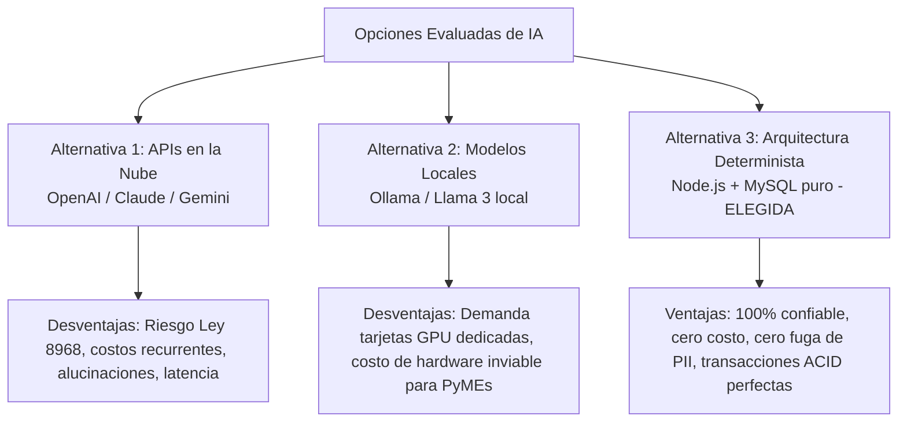

# ADR 0001: Política de Selección de Modelo y Proveedor de Inteligencia Artificial

| Metadato | Valor |
| :--- | :--- |
| **Identificador** | ADR-0001 |
| **Título** | Selección y Política de Integración de Modelos y Proveedores de IA |
| **Estado** | **Aceptado** |
| **Fecha** | 13 de noviembre de 2026 |
| **Autores** | Arquitectura de Software, Seguridad y Gobernanza de Datos |
| **Marco de Referencia** | *Gobernanza de IA y de datos — Taller FWD* (Herramienta 1: Decidir por escrito antes de construir; Herramienta 5: Datos personales; Herramienta 6: Responsabilidad) |

---

## 1. Contexto

**StockPro** es un sistema empresarial de administración de inventarios, proveedores, clientes y movimientos de mercancía diseñado para operar en pequeñas y medianas tiendas, ferreterías y comercios minoristas. El sistema gestiona activos de alta criticidad operativa y financiera: catálogo de productos, existencias en almacén, precios de venta, costos unitarios y datos personales identificativos de clientes (cédulas físicas y jurídicas, teléfonos, correos y direcciones residenciales en Costa Rica bajo el marco de la **Ley N° 8968**).

En la industria actual existe una tendencia acelerada a incorporar capacidades de Inteligencia Artificial Generativa (LLMs) y agentes autónomos dentro de herramientas administrativas bajo la premisa de "modernización" (asistentes conversacionales, generación automática de órdenes de compra, clasificación de inventario y análisis predictivo).

---

## 2. El Problema

La integración indiscriminada o prematura de proveedores de IA en un sistema transaccional de inventarios plantea desafíos críticos:

1. **Soberanía y Privacidad de Datos:** El envío de información transaccional y datos personales de clientes a APIs públicas o comerciales de terceros (por ejemplo, OpenAI, Anthropic, Google Cloud Vertex AI) implica una transferencia transfronteriza de datos que puede vulnerar el artículo 14 de la Ley 8968 de Costa Rica si no existe consentimiento informado expreso ni contratos de procesamiento de datos con garantías adecuadas.
2. **Determinismo vs. Probabilismo:** La gestión de existencias de almacén y la prevención de ventas sin stock exigen reglas matemáticas y transaccionales **100% deterministas (ACID)**. Un modelo de lenguaje opera de manera probabilística, sujeto a alucinaciones, omisiones y desvíos que en un inventario conllevan descalabros contables y discrepancias de existencias.
3. **Costos y Dependencia:** Las APIs en la nube cobran por volumen de tokens y peticiones, lo cual es inviable o contraproducente para el perfil económico de pequeños comercios de barrio, además de introducir puntos únicos de fallo y latencia de red.
4. **Rendición de Cuentas (Caso Moffatt v. Air Canada):** Como se analizó en el *Taller FWD*, los tribunales han sentado jurisprudencia inequívoca: las empresas responden legalmente por lo que afirme o ejecute un sistema computacional; "lo dijo la IA" no constituye eximente de responsabilidad.

---

## 3. Decisión

Se adopta de manera formal y vinculante la siguiente decisión arquitectónica:

1. **Estado Actual: Cero Proveedores de IA en Tiempo de Ejecución (Runtime):**
   StockPro **NO integrará ningún proveedor ni modelo de Inteligencia Artificial (ni en la nube ni local)** dentro del flujo operativo o transaccional de producción. El núcleo del sistema permanecerá 100% determinista, gobernado por Node.js, Express y MySQL 8.0 con transacciones ACID y bloqueo pesimista de filas.
2. **Prohibición Estricta de Fuga de Datos:**
   Queda terminantemente prohibido crear rutas, servicios o funciones en el backend o frontend que transmitan bases de datos, catálogos, movimientos de inventario o datos personales de clientes a APIs externas de modelos de lenguaje o procesamiento de texto.
3. **Uso de Asistentes de IA en Desarrollo:**
   Se autoriza el uso de herramientas de asistencia de código para desarrolladores (como Antigravity, Copilot o Cursor) **únicamente durante la fase de autoría y revisión de software**, bajo la restricción inquebrantable estipulada en `AGENTS.md`: **ninguna base de datos de clientes reales ni credenciales de producción podrá ser incluida en los prompts o contextos de depuración**.
4. **Requisitos Mandatorios para una Eventual Integración Futura:**
   En caso de que en una versión posterior se justifique la adición de una función asistida por IA (por ejemplo, clasificación sugerida de categorías o pronóstico estacional de demanda), la misma deberá cumplir sin excepción:
   - Realización de una Evaluación de Impacto en la Protección de Datos (EIPD / DPIA).
   - Anonimización y agregación total previa (ningún dato personal podrá salir de la base de datos).
   - Acuerdos contractuales de procesamiento de datos (DPA) que certifiquen que la información enviada **no será utilizada para entrenar modelos**.
   - Arquitectura de recomendación con validación humana obligatoria (*Human-in-the-Loop*), donde la IA solo propone pero no ejecuta.

---

## 4. Alternativas Consideradas

### Alternativa 1: Integración de APIs Comerciales en la Nube (OpenAI / Anthropic / Google Vertex)
- **Descripción:** Conectar el backend de Express mediante llamadas HTTP a endpoints de LLMs para responder dudas o categorizar productos.
- **Motivo de Rechazo:**
  - Riesgo inaceptable de incumplimiento normativo ante la Agencia de Protección de Datos de los Habitantes (Prodhab) por transferencia no consentida de PII de clientes.
  - Dependencia de conectividad a Internet de alta disponibilidad en comercios locales.
  - Costo financiero recurrente por consumo de tokens que erosiona el margen operativo de tiendas pequeñas.

### Alternativa 2: Modelos de Código Abierto Autoalojados (Ollama con Llama 3 o Mistral 7B)
- **Descripción:** Ejecutar un modelo de lenguaje en la misma máquina local del comercio para responder consultas en lenguaje natural sin enviar datos al exterior.
- **Motivo de Rechazo:**
  - Requiere infraestructura de hardware especializada (mínimo 16 GB de RAM y GPU dedicada de 8 GB VRAM), lo cual duplica o triplica el costo de adquisición de hardware para un comercio modesto que típicamente opera en equipos de escritorio estándar o laptops convencionales.
  - Mayor complejidad de instalación, mantenimiento y actualización en entornos no técnicos.

### Alternativa 3: Arquitectura Determinista Basada en Código Transaccional Puro (Seleccionada)
- **Descripción:** Basar el 100% de la lógica de inventario, consultas, filtros y transacciones en código JavaScript estructurado y consultas SQL preparadas con el motor relacional InnoDB de MySQL.
- **Motivo de Selección:**
  - Exactitud matemática del 100% en control de existencias.
  - Cero costo operativo por procesamiento algorítmico.
  - Rendimiento óptimo con latencia menor a 5 milisegundos en consultas locales.
  - Garantía absoluta de privacidad bajo la Ley 8968 al no existir vector de exfiltración hacia proveedores externos.

---

## 5. Consecuencias

### 5.1 Consecuencias Positivas
- **Cero Riesgo de Alucinación:** El stock de productos jamás será alterado o informado con cifras fabricadas por un modelo generativo.
- **Cumplimiento Normativo Inmediato:** Se elimina el vector principal de sanciones por transferencias internacionales ilícitas de datos personales ante Prodhab.
- **Estabilidad y Disponibilidad:** El sistema opera íntegramente de manera local o en servidor privado sin depender de interrupciones de servicio de proveedores externos de IA.
- **Costos Predecibles y Bajos:** No existen costos mensuales por consumo de APIs ni necesidad de adquirir costosas estaciones de trabajo con GPUs para correr modelos locales.

### 5.2 Consecuencias Negativas
- No se ofrecen interfaces en lenguaje natural ("preguntarle a la tienda qué producto se vende más").
- Los reportes y filtros deben utilizarse mediante las interfaces estructuradas tradicionales de React (filtros por categoría, búsqueda por texto exacto, tablas de movimientos).
- No hay recomendaciones automáticas de compra basadas en procesamiento de lenguaje natural.

---

## 6. Riesgos Pendientes

- **Presión del Mercado:** Expectativa de clientes o evaluadores que demanden "funciones de IA" por motivos de mercadotecnia. (Mitigación: Educar en que la fiabilidad contable y la protección de datos priman sobre características cosméticas no deterministas).
- **Inyección Indirecta de Prompts:** Si en el futuro se implementa algún módulo de búsqueda semántica, la entrada de usuarios en campos libres como `descripcion` podría ser utilizada como vector de ataque. (Mitigación: Mantener vigente la Herramienta 4 del Taller FWD reflejada en `AGENTS.md`).

---

## 7. Condiciones para Revisar esta Decisión

Esta decisión se mantendrá inmutable a menos que concurran simultáneamente las siguientes tres condiciones:

1. **Requerimiento Funcional Validado:** Que exista un caso de uso comercial donde los métodos deterministas tradicionales (SQL y estadísticas descriptivas) sean objetivamente insuficientes.
2. **Garantía Técnica de Privacidad:** Que se cuente con un modelo local ejecutable en CPU estándar de bajo consumo o un proveedor de nube con certificación de residencia local de datos y contrato DPA de no retención verificado.
3. **Aprobación Formal de Gobernanza:** Que se elabore una adenda al presente documento (ADR-0001-A) con firma del Responsable de Seguridad y del Oficial de Cumplimiento de la Ley 8968.

