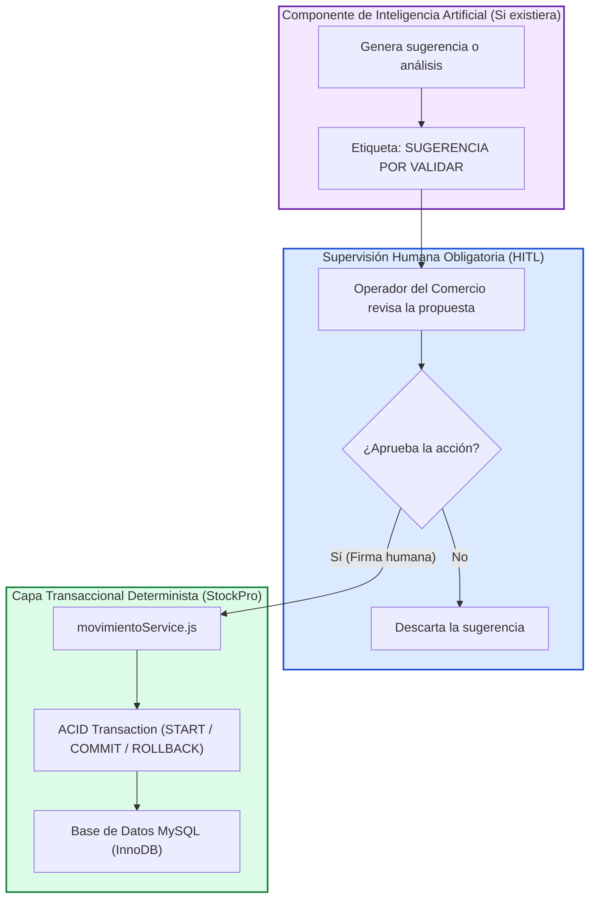

# ADR 0002: Delimitación de Autoridad y Decisiones de la Inteligencia Artificial

| Metadato | Valor |
| :--- | :--- |
| **Identificador** | ADR-0002 |
| **Título** | Límites Operativos, Jurisdiccionales y Decisiones Automatizadas de IA |
| **Estado** | **Aceptado** |
| **Fecha** | 13 de noviembre de 2026 |
| **Autores** | Arquitectura de Software, Seguridad y Gobernanza de Datos |
| **Marco de Referencia** | *Gobernanza de IA y de datos — Taller FWD* (Herramienta 2: Estándares; Herramienta 3: Límites para agentes; Herramienta 6: Responsabilidad y Caso Moffatt v. Air Canada; Casos Workday/Salta sobre sesgo algorítmico) |

---

## 1. Contexto

En el desarrollo y operación de sistemas administrativos como **StockPro**, la automatización de flujos y la eventual integración de herramientas inteligentes plantean una interrogante de gobernanza ineludible: **¿Quién decide qué en el sistema?**

La delegación de autoridad a algoritmos o modelos de aprendizaje automático puede provocar consecuencias catastróficas cuando se les permite tomar decisiones operativas, contables o contractuales de forma autónoma:
- El caso **Moffatt v. Air Canada** (Tribunal de Resolución Civil de Columbia Británica, 2024) demostró que una empresa no puede desligarse de la responsabilidad civil y contractual por las respuestas o cálculos erróneos emitidos por un asistente automatizado.
- Las controversias y demandas recientes sobre selección y categorización automatizada (casos como **Workday**, algoritmos de scoring crediticio y disputas de perfiles de clientes) han evidenciado que la delegación descontrolada de decisiones sobre personas físicas genera sesgos sistemáticos, discriminación ilegal e infracciones graves a las leyes de protección de datos (como la **Ley N° 8968** de Costa Rica).

---

## 2. El Problema

Si un componente de Inteligencia Artificial (o un agente automatizado en segundo plano) tuviera potestad para alterar registros o tomar decisiones en StockPro:
1. Podría ordenar salidas o ajustes de inventario basándose en deducciones erróneas o alucinadas, rompiendo la trazabilidad contable y provocando pérdidas de mercancía.
2. Podría clasificar, dar de baja o rechazar clientes de forma discriminatoria o sin fundamento objetivo.
3. Podría ofrecer descuentos indebidos, modificar precios de venta al público o alterar costos unitarios de proveedores, afectando la solvencia del comercio.
4. Crearía un vacío de responsabilidad jurídica donde los operadores humanos intentarían excusarse bajo la premisa de *"lo hizo el sistema automáticamente"*.

---

## 3. Decisión

Se establece con carácter vinculante y permanente el siguiente marco de delimitación de autoridad en **StockPro**:

### 3.1 Prohibición Expresa de Decisiones Autónomas Críticas (Lista Negativa)
El sistema prohíbe de forma absoluta que cualquier componente de IA, script autónomo o modelo de lenguaje tome decisiones sobre los siguientes aspectos:

1. **Alteración de Existencias de Inventario:**
   Ningún modelo puede insertar, modificar o eliminar registros en las tablas `movimientos`, `detalle_movimientos` ni alterar la columna `stock` de la tabla `productos`. La totalidad de los movimientos debe originarse mediante una acción humana consciente y ejecutarse a través de la lógica transaccional estricta del backend (`movimientoService.js`).
2. **Decisiones sobre Clientes y Personas Físicas:**
   La IA **NO puede decidir la admisión, categorización de riesgo, suspensión o baja de ningún cliente**. Ninguna persona puede ser sometida a discriminación o trato diferenciado en precios, créditos o atención a partir de perfiles algorítmicos no autorizados expresamente por la legislación nacional (Ley 8968).
3. **Modificación de Precios, Costos y Condiciones Financieras:**
   Queda prohibido el ajuste dinámico o automático de precios de venta o costos de compra mediante modelos de optimización no supervisados. Los precios son fijados exclusivamente por la administración del comercio.
4. **Eliminación o Mutación de Catálogos Maestros:**
   Ningún agente o modelo tiene autorización para ejecutar operaciones `DELETE` o mutaciones masivas sobre las entidades `categorias`, `proveedores`, `productos` o `clientes`.

### 3.2 Principio "Human-in-the-Loop" (El Humano en el Centro)
Cualquier función inteligente que se incorpore en fases futuras a StockPro estará limitada con carácter estricto al rol de **asistencia consultiva e informativa**:
- Las sugerencias (por ejemplo, "sugerencia de reposición de stock") se presentarán en la interfaz únicamente como una propuesta no vinculante, etiquetada explícitamente como:
  > `[SUGERENCIA DE IA - REQUIERE VALIDACIÓN HUMANA]`
- Ninguna acción operativa se ejecutará sin que un operador humano responsable presione deliberadamente un botón de confirmación en la interfaz gráfica.

### 3.3 Principio de Responsabilidad Ineludible ("Lo dijo la IA no es defensa")
De conformidad con los principios rectores del *Taller FWD* y la jurisprudencia comparada:
- **Las personas físicas y jurídicas titulares del comercio son las únicas responsables ante clientes, proveedores y autoridades.**
- En ningún caso se admitirá como eximente contable, contractual o legal la afirmación de que una inconsistencia de existencias, un error de precios o un perjuicio a un cliente fue causado por una recomendación o procesamiento de IA.

---

## 4. Alternativas Consideradas

### Alternativa 1: Autonomía Completa de Agentes (Reabastecimiento Automático)
- **Descripción:** Permitir que un agente de IA envíe órdenes de compra a proveedores cuando el stock caiga por debajo del umbral mínimo.
- **Motivo de Rechazo:** Riesgo financiero grave por sobrestock, pedidos a proveedores equivocados o colapsos de liquidez si el algoritmo falla en calibrar la demanda.

### Alternativa 2: Decisiones Híbridas sin Confirmación Explícita
- **Descripción:** La IA ajusta el stock o categoriza clientes automáticamente y notifica por correo al administrador después del hecho.
- **Motivo de Rechazo:** Rompe el principio de control preventivo. En caso de daño al cliente (por ejemplo, suspensión indebida) o distorsión de inventario, la reversión es compleja y costosa.

### Alternativa 3: Restricción Absoluta y Paradigma Human-in-the-Loop (Seleccionada)
- **Descripción:** La IA tiene cero potestad de escritura en la base de datos operativa. Solo produce sugerencias que el usuario humano debe validar y autorizar activamente.
- **Motivo de Selección:** Máxima seguridad jurídica, preservación de la confianza del comercio y alineación perfecta con las mejores prácticas internacionales de gobernanza.

---

## 5. Consecuencias

### 5.1 Consecuencias Positivas
- **Inviolabilidad de la Cadena de Responsabilidad:** Existe siempre un operador humano claramente identificable para cada transacción registrada en el sistema.
- **Prevención de Discriminación y Sesgos:** Los clientes y proveedores reciben un trato uniforme y auditable, sin perfiles opacos de caja negra.
- **Seguridad Operativa y Contable:** El inventario solo se modifica cuando hay un comprobante físico o una decisión humana verificable de entrada o salida.

### 5.2 Consecuencias Negativas
- Los procesos de compra y ajuste de inventario requieren la intervención activa del personal del comercio (no hay "piloto automático total").
- El flujo de trabajo administrativo puede requerir más clics o pasos de confirmación en la interfaz gráfica.

---

## 6. Riesgos Pendientes

- **Fatiga de Alertas o Complacencia del Operador:** Si un operador humano se acostumbra a presionar "Aceptar" sin leer las advertencias de la interfaz, el control humano podría degradarse a una simple formalidad. (Mitigación: Diseñar interfaces con resúmenes claros de impacto financiero antes de confirmar acciones críticas).

---

## 7. Condiciones para Revisar esta Decisión

La prohibición de decisiones autónomas sobre inventario, datos personales y precios tiene vigencia indefinida. Solo podrá revisarse la delegación de acciones mecánicas de bajísimo riesgo (como depuración de cachés temporales o generación de borradores de catálogo) mediante un nuevo ADR formalmente ratificado por el equipo de gobernanza.

