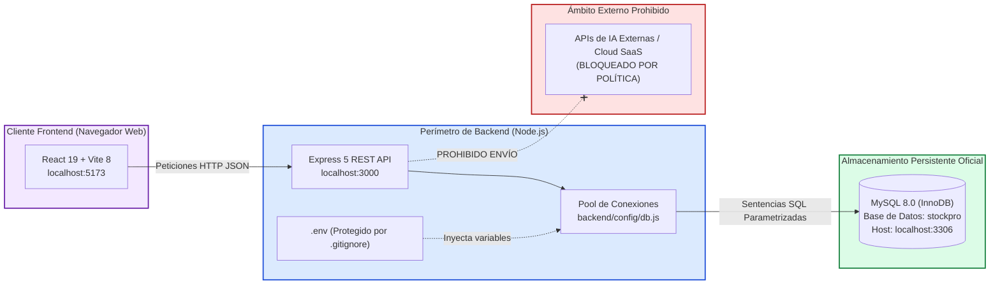

# ADR 0003: Residencia, Soberanía y Perímetro de Almacenamiento de los Datos

| Metadato | Valor |
| :--- | :--- |
| **Identificador** | ADR-0003 |
| **Título** | Política de Residencia, Fronteras de Almacenamiento y Seguridad de Datos |
| **Estado** | **Aceptado** |
| **Fecha** | 13 de noviembre de 2026 |
| **Autores** | Arquitectura de Software, Seguridad y Gobernanza de Datos |
| **Marco de Referencia** | *Gobernanza de IA y de datos — Taller FWD* (Herramienta 1: Decidir por escrito; Herramienta 5: Datos personales y soberanía bajo Ley 8968; Inventario de Datos de StockPro) |

---

## 1. Contexto

La arquitectura técnica de **StockPro** administra el núcleo operacional de comercios minoristas y tiendas locales. Este sistema procesa información de dos naturalezas distintas:
1. **Datos Operativos y Comerciales:** Catálogos de productos, categorías, proveedores mayoristas, existencias de inventario, costos unitarios, márgenes de venta y movimientos de almacén.
2. **Datos Personales de Clientes:** Nombres completos de personas físicas, números de cédula física o DIMEX, teléfonos de contacto, correos electrónicos y direcciones de entrega física.

De acuerdo con la legislación costarricense (**Ley N° 8968** de Protección de la Persona frente al Tratamiento de sus Datos Personales y su Reglamento), el almacenamiento y tratamiento de datos personales de acceso restringido exige delimitar claramente la **ubicación física o lógica de las bases de datos**, las medidas de seguridad adoptadas para prevenir su extravío o acceso ilegítimo, y los protocolos para transferencias de información dentro y fuera del territorio nacional (Artículos 4, 10 y 14 de la Ley).

---

## 2. El Problema

Frecuentemente, en proyectos de modernización de software ocurren desviaciones graves en el ciclo de vida del dato:
- Dispersión no controlada de información ("Data Sprawl"): exportaciones manuales a hojas de cálculo compartidas en servicios de consumo (Google Drive personal, Dropbox, WhatsApp), donde los datos personales pierden control de acceso.
- Alojamiento en servidores extranjeros sin garantías contractuales ni evaluación de equivalencia de protección según los estándares de la **Prodhab** (Agencia de Protección de Datos de los Habitantes).
- Exposición directa del motor de base de datos a redes públicas o clientes frontend sin pasar por una capa de abstracción controlada.
- Filtración accidental de secretos y credenciales de acceso a través del código fuente versionado en repositorios remotos.

---

## 3. Decisión

Se adopta de manera formal y estricta la siguiente política de residencia, límites perimetrales y almacenamiento de datos para **StockPro**:

### 3.1 Residencia Principal: Base de Datos Relacional MySQL 8.0 Local / Servidor Dedicado
1. **Motor de Almacenamiento Oficial:**
   El único repositorio oficial y autorizado para los datos de StockPro es el motor relacional **MySQL 8.0**, utilizando el motor transaccional **InnoDB** y codificación de caracteres `utf8mb4` con colación `utf8mb4_unicode_ci`.
2. **Nombre de la Base de Datos:** `stockpro`.
3. **Esquema Cerrado de Seis Entidades:**
   Los datos residen exclusivamente en las seis tablas normalizadas definidas en `database/stockpro.sql`:
   - `categorias`
   - `proveedores`
   - `productos`
   - `clientes`
   - `movimientos`
   - `detalle_movimientos`
   Queda prohibido crear bases de datos secundarias, archivos SQLite no supervisados o almacenamiento disperso en archivos planos de texto para almacenar transacciones.

### 3.2 Perímetro de Acceso y Aislamiento Arquitectónico
1. **Cero Acceso Directo desde el Frontend:**
   La aplicación cliente en React 19 **no tiene ni tendrá credenciales ni conexión directa con el motor MySQL**. Todo acceso a los datos ocurre estrictamente a través de peticiones HTTP/REST mediadas por el servidor backend en Node.js y Express 5.
2. **Pool de Conexiones Centralizado:**
   El backend se comunica con MySQL a través de un pool de conexiones administrado en `backend/config/db.js` (`mysql2/promise`). Este archivo lee los parámetros de red exclusivamente desde variables de entorno locales.
3. **Aislamiento de Secretos y Credenciales:**
   - Las credenciales (`DB_HOST`, `DB_USER`, `DB_PASSWORD`, `DB_NAME`, `DB_PORT`) residen estrictamente en el archivo local `.env` del servidor.
   - El archivo `.gitignore` del proyecto excluye de forma garantizada cualquier archivo de entorno (`.env`, `.env.local`), asegurando que ninguna contraseña o dirección IP sensible sea versionada en GitHub ni en ningún repositorio externo.
   - En el repositorio solo se versiona `backend/.env.example` con valores de muestra ficticios.

### 3.3 Prohibición de Dispersión y Transferencia Transfronteriza No Regulada
1. **Prohibición de Sincronización Externa no Autorizada:**
   Queda estrictamente prohibido implementar plugins, webhooks o scripts en segundo plano que envíen datos de clientes o existencias de productos a plataformas SaaS de terceros, herramientas de analítica en la nube o modelos de IA externos, sin previa autorización formal del Oficial de Privacidad del comercio.
2. **Cumplimiento del Artículo 14 de la Ley 8968 (Transferencias Internacionales):**
   Los datos personales de ciudadanos costarricenses registrados en StockPro no podrán ser alojados en servicios de nube cuyos centros de datos se ubiquen en jurisdicciones que no garanticen un nivel de protección adecuado equiparable al costarricense, salvo consentimiento expreso e informado del titular del dato.

---

## 4. Alternativas Consideradas

### Alternativa 1: Migración a Base de Datos Serverless en la Nube (Supabase / Firebase / AWS Aurora)
- **Descripción:** Desalojar el MySQL local y apuntar el sistema a una base de datos gestionada en la nube multi-tenant.
- **Motivo de Rechazo:**
  - Introduce costos mensuales recurrentes en dólares para pequeños comercios de bajo margen.
  - Implica transferencia internacional de datos hacia servidores en EE.UU. o Europa, requiriendo registro formal y justificación legal de transferencia ante la Prodhab.
  - Genera dependencia de conectividad constante a Internet en la caja de cobro del comercio.

### Alternativa 2: Almacenamiento Local en Motor MySQL 8.0 (Seleccionada)
- **Descripción:** El motor MySQL 8.0 se ejecuta en el servidor del comercio o en un host privado controlado localmente.
- **Motivo de Selección:**
  - Máxima soberanía sobre los datos: la información permanece físicamente dentro de las instalaciones del comercio o en su servidor dedicado.
  - Cumplimiento directo y simplificado de los requerimientos de la Ley 8968.
  - Operatividad garantizada incluso si el comercio sufre caídas de conexión a Internet externa.
  - Cero costos adicionales de suscripción de infraestructura.

### Alternativa 3: Almacenamiento Híbrido con Copias en Hojas de Cálculo (Google Sheets API)
- **Descripción:** Sincronizar automáticamente cada venta y cliente a una hoja de cálculo en la nube.
- **Motivo de Rechazo:**
  - Gravísimo riesgo de seguridad y filtración de datos personales al dispersar información sensible en cuentas de correo corporativas o personales sin control granular de acceso.

---

## 5. Consecuencias

### 5.1 Consecuencias Positivas
- **Control Físico y Lógico Total:** El propietario del comercio mantiene la tenencia y custodia efectiva de su información contable y de sus clientes.
- **Cumplimiento de Privacidad:** Se elimina el riesgo de litigios o infracciones por transferencias transfronterizas indebidas.
- **Desempeño:** Tiempos de respuesta extremadamente veloces al no existir latencia de red hacia servidores remotos.

### 5.2 Consecuencias Negativas y Deberes Operativos
- **Responsabilidad del Respaldo:** Al residir los datos localmente, el comercio y el administrador de sistemas asumen la obligación ineludible de ejecutar copias de seguridad periódicas (*backups*) para prevenir pérdidas por fallas de hardware.
- **Escalabilidad Multisede:** Si el comercio abre sucursales geográficamente distantes, el esquema local requerirá evolucionar hacia un enlace seguro mediante VPN o migración planificada a un entorno cloud privado.

---

## 6. Riesgos Pendientes

- **Pérdida por Desastre Local o Daño Físico (RSK-DAT-09):** Si el servidor local sufre un daño de disco duro o incendio, la base de datos podría destruirse si no existen respaldos externos. (Mitigación: Implementar procedimiento documentado de volcado lógico diario mediante `mysqldump` con almacenamiento en disco externo cifrado).

---

## 7. Condiciones para Revisar esta Decisión

Esta decisión se revisará exclusivamente cuando:
1. El comercio adopte un modelo de franquicia o múltiples sucursales que requieran una base de datos unificada en tiempo real.
2. Se contrate un centro de datos en la nube con certificación de residencia territorial en Costa Rica o un proveedor internacional que certifique el cumplimiento integral de los estándares de la Ley 8968 y aprobación expresa de Prodhab.

