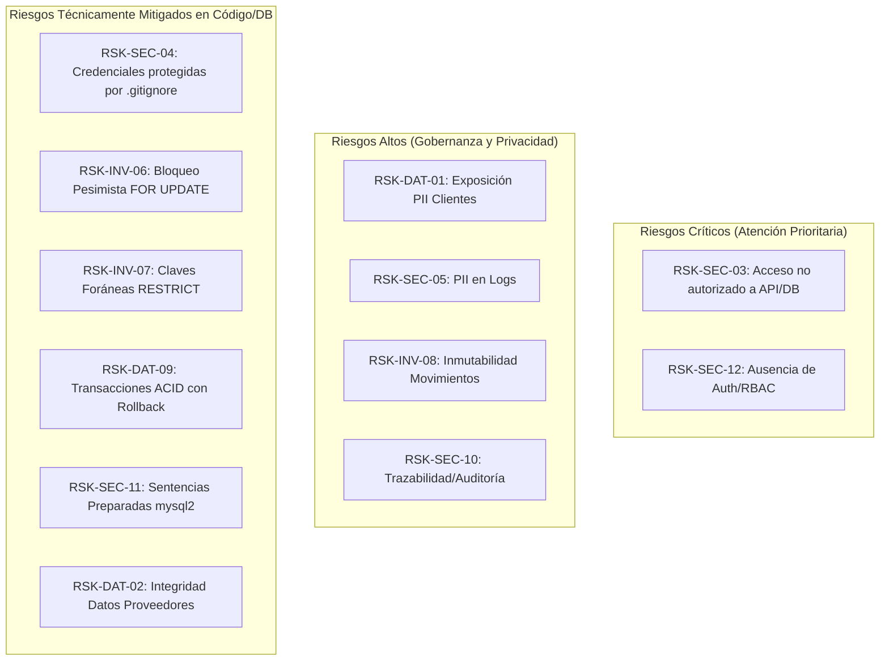
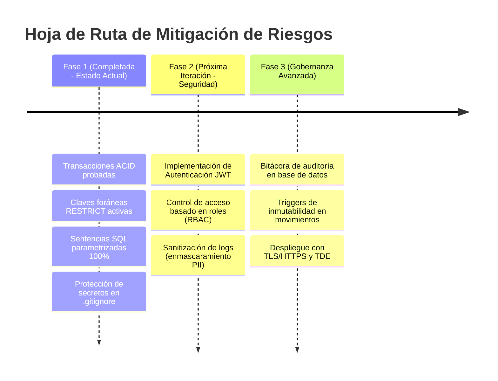

# Registro de Riesgos de Datos, Seguridad e Inteligencia Artificial
## StockPro — Sistema Empresarial de Inventarios y Clientes

| Metadato | Detalle |
| :--- | :--- |
| **Documento** | Registro Formal de Riesgos de Seguridad, Privacidad y Gobernanza de Datos |
| **Proyecto** | StockPro (Inventarios y Gestión de Clientes para Comercios) |
| **Versión** | 1.0.0 |
| **Fecha de emisión** | 13 de noviembre de 2026 |
| **Marco de referencia** | *Gobernanza de IA y de datos — Taller FWD* (Fundación Forward Costa Rica) Ley N° 8968 (Protección de la Persona frente al Tratamiento de sus Datos Personales - Costa Rica) OWASP Top 10 API Security Risks |
| **Estado de auditoría** | Documentado formalmente con base en inspección de código y base de datos |

---

## 1. Metodología de Evaluación de Riesgos

La presente matriz evalúa los riesgos operativos, de seguridad de la información, de privacidad de datos y de interacción con inteligencia artificial para la plataforma **StockPro**. Cada riesgo se evalúa según dos dimensiones objetivas:

### 1.1 Escala de Probabilidad
- **Baja (1):** Evento improbable o que requiere una cadena compleja de fallos y accesos privilegiados.
- **Media (2):** Evento plausible bajo condiciones normales de operación o despliegue en red local.
- **Alta (3):** Evento muy probable si el sistema se expone a entornos desprotegidos o redes públicas sin controles perimetrales.

### 1.2 Escala de Impacto
- **Bajo (1):** Afectación operativa menor, sin pérdida financiera ni compromiso de datos personales.
- **Medio (2):** Degradación temporal del servicio, inconsistencias menores subsanables o afectación limitada a registros no críticos.
- **Alto (3):** Pérdida o corrupción de inventario, afectación transaccional o filtración de datos de contacto comercial.
- **Crítico (4):** Exposición masiva de datos personales (PII bajo Ley 8968), robo de credenciales maestras de base de datos o corrupción irreversible de existencias.

### 1.3 Matriz de Severidad (Nivel de Riesgo)
$$\text{Nivel de Riesgo} = \text{Probabilidad} \times \text{Impacto}$$

- **Bajo (1 - 2):** Monitoreo periódico y buenas prácticas de desarrollo.
- **Medio (3 - 4):** Requiere controles preventivos documentados y mitigación planificada.
- **Alto (6 - 8):** Requiere intervención técnica prioritaria antes de despliegues en producción abierta.
- **Crítico (9 - 12):** Requiere salvaguardas inmediatas y bloqueos arquitectónicos estrictos.

---

## 2. Matriz Consolidada de los 12 Riesgos Normativos y Operativos

A continuación se detalla la matriz de los doce riesgos obligatorios identificados en la arquitectura actual de StockPro, diferenciando estrictamente entre **medidas preventivas ya existentes y comprobadas en el código** y **medidas recomendadas pendientes de implementación**.

| ID | Riesgo | Activos Afectados | Prob. | Imp. | Severidad | Estado |
| :--- | :--- | :--- | :---: | :---: | :---: | :---: |
| **RSK-DAT-01** | Exposición no autorizada de datos personales de clientes (PII) | Tabla `clientes`, API `/api/clientes`, frontend | Media | Crítico | **Alto (8)** | Parcialmente Mitigado |
| **RSK-DAT-02** | Exposición o uso indebido de datos de proveedores y contactos | Tabla `proveedores`, API `/api/proveedores` | Media | Medio | **Medio (4)** | Parcialmente Mitigado |
| **RSK-SEC-03** | Acceso no autorizado a la base de datos MySQL por falta de autenticación | Base de datos `stockpro`, API REST completa | Alta | Crítico | **Crítico (12)** | Pendiente de Implementación |
| **RSK-SEC-04** | Filtración de credenciales de base de datos en repositorio | Archivos `.env`, `config/db.js`, Git | Baja | Crítico | **Medio (4)** | Mitigado en Repositorio |
| **RSK-SEC-05** | Registro involuntario de PII o secretos en logs de consola/servidor | `middlewares/errorHandler.js`, `server.js` | Media | Alto | **Alto (6)** | Pendiente de Implementación |
| **RSK-INV-06** | Modificación errónea de existencias por condiciones de carrera | Tabla `productos`, `movimientoService.js` | Baja | Crítico | **Medio (4)** | Mitigado en Código |
| **RSK-INV-07** | Eliminación accidental de registros maestros con dependencias | `categorias`, `proveedores`, `clientes`, `productos` | Baja | Alto | **Medio (3)** | Mitigado en Base de Datos |
| **RSK-INV-08** | Manipulación indebida de movimientos de inventario históricos | Tablas `movimientos`, `detalle_movimientos` | Media | Alto | **Alto (6)** | Parcialmente Mitigado |
| **RSK-DAT-09** | Inconsistencia de datos por transacciones incompletas o fallas | Transacciones de inventario, stock de productos | Baja | Crítico | **Medio (4)** | Mitigado en Código |
| **RSK-SEC-10** | Falta de trazabilidad y auditoría de acciones administrativas | Bitácora del sistema, acciones CRUD | Alta | Medio | **Alto (6)** | Pendiente de Implementación |
| **RSK-SEC-11** | Inyección SQL mediante consultas no parametrizadas | Capa de modelos backend (`*Model.js`) | Baja | Crítico | **Medio (4)** | Mitigado en Código |
| **RSK-SEC-12** | Ausencia de autenticación y autorización (RBAC) en API REST | Todos los endpoints Express (`routes/*.js`) | Alta | Crítico | **Crítico (12)** | Pendiente de Implementación |

---

## 3. Fichas Detalladas de Gestión de Riesgos

---

### Ficha RSK-DAT-01: Exposición no autorizada de datos personales de clientes (PII)

- **Identificador:** `RSK-DAT-01`
- **Categoría:** Privacidad y Protección de Datos Personales (Ley 8968 Costa Rica).
- **Descripción:** Acceso, extracción o visualización no autorizada de nombres de personas físicas, números de cédula/identificación, teléfonos, correos electrónicos y direcciones físicas almacenadas en la entidad `clientes`.
- **Activos Afectados:** Tabla `clientes`, endpoint `GET /api/clientes`, endpoint `GET /api/clientes/:id`, componentes `ClientesList.jsx` y `ClienteModal.jsx`.
- **Probabilidad:** Media (2) | **Impacto:** Crítico (4) | **Nivel de Riesgo:** **Alto (8)**
- **Medidas Preventivas Existentes (Comprobadas):**
  1. Validación en backend (`clienteModel.js`) de campo único para identificación (`ER_DUP_ENTRY`), evitando suplantación o duplicidad de identificadores.
  2. Uso de sentencias SQL parametrizadas que impiden exfiltración masiva mediante inyección SQL clásica.
  3. Restricción de eliminación física cuando el cliente posee movimientos asociados (`ON DELETE RESTRICT`).
- **Medidas Recomendadas (Pendientes de Implementación):**
  1. Implementar autenticación (JWT) y autorización basada en roles (RBAC) para restringir el acceso a la lista completa de clientes únicamente a roles gerenciales o administrativos.
  2. Implementar paginación obligatoria y límites de consulta (`LIMIT 50`) en `GET /api/clientes` para prevenir scraping masivo.
  3. Enmascarar números de teléfono y direcciones en vistas generales donde no sea estrictamente necesario el dato completo.
  4. Incorporar cláusula de consentimiento informado en el formulario de alta de cliente físico conforme a los artículos 5 y 9 de la Ley 8968.
- **Responsable:** Arquitecto de Software y Oficial de Cumplimiento de Datos.
- **Estado:** Parcialmente Mitigado (seguridad lógica de base de datos activa; seguridad a nivel de capa de aplicación y autenticación pendiente).

---

### Ficha RSK-DAT-02: Exposición o uso indebido de datos de proveedores y contactos comerciales

- **Identificador:** `RSK-DAT-02`
- **Categoría:** Confidencialidad Comercial y Gobernanza de Datos.
- **Descripción:** Divulgación no autorizada de la cartera de proveedores comerciales, personas de contacto, teléfonos y condiciones de suministro a terceros o competidores del comercio.
- **Activos Afectados:** Tabla `proveedores`, endpoint `GET /api/proveedores`, componente `ProveedoresList.jsx`.
- **Probabilidad:** Media (2) | **Impacto:** Medio (2) | **Nivel de Riesgo:** **Medio (4)**
- **Medidas Preventivas Existentes (Comprobadas):**
  1. Base de datos no expuesta directamente a la red; acceso únicamente a través de la API local de Node.js.
  2. Integridad referencial con `productos` mediante clave foránea `fk_productos_proveedor` con regla `ON DELETE RESTRICT`, evitando que se elimine o desvincule arbitrariamente un proveedor activo.
- **Medidas Recomendadas (Pendientes de Implementación):**
  1. Control de acceso restringido para personal de compras y administración.
  2. Registro de auditoría de descargas o exportaciones de la lista de proveedores.
- **Responsable:** Administrador del Sistema / Desarrollador Backend.
- **Estado:** Parcialmente Mitigado.

---

### Ficha RSK-SEC-03: Acceso no autorizado a la base de datos MySQL

- **Identificador:** `RSK-SEC-03`
- **Categoría:** Seguridad de Infraestructura y Control de Acceso.
- **Descripción:** Conexión directa a la base de datos `stockpro` desde terminales o clientes externos sin autorización, o ejecución de consultas arbitrarias sobre los datos empresariales.
- **Activos Afectados:** Servidor MySQL 8.0, base de datos `stockpro`, usuario de conexión `root`/`app_user`.
- **Probabilidad:** Alta (3) [si se expone en red local o nube] | **Impacto:** Crítico (4) | **Nivel de Riesgo:** **Crítico (12)**
- **Medidas Preventivas Existentes (Comprobadas):**
  1. Parámetro `DB_HOST=localhost` configurado por defecto en `.env`, limitando la escucha de peticiones a la máquina local (`127.0.0.1`).
  2. Conexión gestionada centralizadamente mediante un pool de conexiones controlado (`mysql2/promise` en `backend/config/db.js`), sin exponer puertos directos al cliente web React.
- **Medidas Recomendadas (Pendientes de Implementación):**
  1. Crear un usuario de base de datos con privilegios mínimos dedicados (`GRANT SELECT, INSERT, UPDATE, DELETE ON stockpro.* TO 'stockpro_app'@'localhost'`), eliminando el uso de la cuenta `root`.
  2. Deshabilitar explícitamente el acceso remoto en la configuración del servicio MySQL (`bind-address = 127.0.0.1`).
  3. Cifrado de datos en reposo (Transparent Data Encryption - TDE) en entornos de almacenamiento persistente.
- **Responsable:** Administrador de Base de Datos (DBA) / Especialista en Seguridad.
- **Estado:** Pendiente de Implementación (actualmente en entorno de desarrollo controlado localmente).

---

### Ficha RSK-SEC-04: Filtración de credenciales de base de datos en repositorio

- **Identificador:** `RSK-SEC-04`
- **Categoría:** Gestión de Secretos y Seguridad en el Ciclo de Vida de Desarrollo (DevSecOps).
- **Descripción:** Publicación accidental de contraseñas, usuarios o nombres de bases de datos productivas en repositorios públicos o compartidos de Git (GitHub, GitLab).
- **Activos Afectados:** Archivos `.env`, credenciales en `backend/config/db.js`, repositorio Git.
- **Probabilidad:** Baja (1) | **Impacto:** Crítico (4) | **Nivel de Riesgo:** **Medio (4)**
- **Medidas Preventivas Existentes (Comprobadas):**
  1. Archivo `.gitignore` en la raíz del proyecto configurado exhaustivamente con exclusión de `.env`, `.env.local`, `.env.*.local` y credenciales privadas.
  2. Existencia de plantilla sanitizada `backend/.env.example` con valores de muestra ficticios (`DB_PASSWORD=tu_password_aqui`).
  3. Verificación de auditoría que certifica la ausencia de credenciales expuestas en el historial de código versionado.
- **Medidas Recomendadas (Pendientes de Implementación):**
  1. Integración de ganchos de pre-commit (como `git-secrets` o `trufflehog`) en el pipeline de CI/CD para bloquear commits que contengan patrones de contraseñas.
  2. Implementación de un gestor de secretos (HashiCorp Vault, AWS Secrets Manager o GCP Secret Manager) en entornos de producción.
- **Responsable:** Ingeniero DevSecOps / Desarrollador Backend.
- **Estado:** Mitigado en Repositorio (control preventivo activo en Git).

---

### Ficha RSK-SEC-05: Registro involuntario de PII o secretos en logs de consola/servidor

- **Identificador:** `RSK-SEC-05`
- **Categoría:** Protección de Datos en Tránsito y Auditoría de Logs.
- **Descripción:** Impresión involuntaria en la consola estándar (`console.error`, `console.log`) de objetos completos de error o payloads HTTP que contengan cédulas, teléfonos, correos o credenciales de conexión en caso de fallos.
- **Activos Afectados:** Archivo `backend/middlewares/errorHandler.js`, salida estándar de Node.js (`stdout`/`stderr`), posibles agregadores de logs.
- **Probabilidad:** Media (2) | **Impacto:** Alto (3) | **Nivel de Riesgo:** **Alto (6)**
- **Medidas Preventivas Existentes (Comprobadas):**
  1. El middleware `errorHandler.js` intercepta errores no controlados y responde al cliente únicamente con un mensaje genérico JSON `{ mensaje: 'Error interno del servidor...' }` en lugar de volcar el stack trace completo al usuario final.
- **Medidas Recomendadas (Pendientes de Implementación):**
  1. Reemplazar `console.error(err)` por un logger estructurado (como Winston o Pino) con filtros automáticos de enmascaramiento (sanitizers) para claves sensibles (`password`, `identificacion`, `correo`, `telefono`).
  2. Definir una política de retención y depuración automática para archivos de log en servidores de producción.
- **Responsable:** Especialista en Seguridad de Aplicaciones y Desarrollador Backend.
- **Estado:** Pendiente de Implementación (en desarrollo se imprimen errores técnicos a la consola del desarrollador).

---

### Ficha RSK-INV-06: Modificación errónea de existencias por condiciones de carrera (Race Conditions)

- **Identificador:** `RSK-INV-06`
- **Categoría:** Integridad Transaccional y Lógica de Negocio.
- **Descripción:** Venta o salida simultánea de un producto por dos usuarios o terminales concurrentes cuando el stock disponible es insuficiente, provocando existencias negativas o desincronización de inventario.
- **Activos Afectados:** Tabla `productos` (columna `stock`), tabla `detalle_movimientos`, archivo `backend/services/movimientoService.js`.
- **Probabilidad:** Baja (1) | **Impacto:** Crítico (4) | **Nivel de Riesgo:** **Medio (4)**
- **Medidas Preventivas Existentes (Comprobadas y Auditadas):**
  1. Bloqueo pesimista a nivel de fila mediante `SELECT stock, nombre FROM productos WHERE id_producto = ? FOR UPDATE` ejecutado dentro de la transacción activa.
  2. Validación estricta en memoria: si `nuevoStock < 0`, el servicio arroja una excepción explícita indicando la insuficiencia de existencias.
  3. Ejecución de `await connection.rollback()` inmediato ante cualquier error, garantizando que el stock no se reduzca si la transacción no se completa al 100%.
  4. Suite de pruebas automatizadas (`test_suite.js` y `audit_runner.js`) que verifica la prevención de existencias negativas.
- **Medidas Recomendadas (Pendientes de Implementación):**
  1. Incorporar una restricción a nivel de esquema DDL en MySQL: `ALTER TABLE productos ADD CONSTRAINT chk_stock_no_negativo CHECK (stock >= 0)`.
- **Responsable:** Arquitecto de Software y Desarrollador Backend.
- **Estado:** Mitigado en Código (probado y certificado mediante pruebas unitarias y de integración).

---

### Ficha RSK-INV-07: Eliminación accidental de registros maestros con historial operativo

- **Identificador:** `RSK-INV-07`
- **Categoría:** Integridad Referencial y Pérdida Accidental de Datos.
- **Descripción:** Eliminación de una categoría, proveedor, cliente o producto que ya posee movimientos históricos asociados, lo cual causaría orfandad de registros, descalabro contable o violaciones de integridad.
- **Activos Afectados:** Tablas `categorias`, `proveedores`, `clientes`, `productos`, `movimientos`, `detalle_movimientos`.
- **Probabilidad:** Baja (1) | **Impacto:** Alto (3) | **Nivel de Riesgo:** **Medio (3)**
- **Medidas Preventivas Existentes (Comprobadas):**
  1. Todas las claves foráneas en `database/stockpro.sql` y `migrations/20261104_init_stockpro.sql` están definidas con la cláusula estricta `ON DELETE RESTRICT ON UPDATE CASCADE`.
  2. El backend maneja el error de base de datos `ER_ROW_IS_REFERENCED_2` (código 1451) retornando un código HTTP `400 Bad Request` con mensaje claro de advertencia al usuario.
  3. En la entidad `clientes` y `categorias`, se implementa además una bandera de borrado lógico / estado booleano (`estado = true / false`).
- **Medidas Recomendadas (Pendientes de Implementación):**
  1. Generalizar el patrón de *Soft Delete* (borrado lógico con columna `deleted_at`) a las tablas `productos` y `proveedores` para preservar el historial visual completo en auditorías fiscales.
- **Responsable:** Administrador de Base de Datos y Desarrollador Backend.
- **Estado:** Mitigado en Base de Datos y Backend.

---

### Ficha RSK-INV-08: Manipulación indebida de movimientos de inventario históricos

- **Identificador:** `RSK-INV-08`
- **Categoría:** Inmutabilidad Contable y Auditoría Forense.
- **Descripción:** Modificación o eliminación posterior de un registro de entrada, salida o ajuste en las tablas `movimientos` o `detalle_movimientos`, alterando el historial de auditoría o encubriendo faltantes de mercancía.
- **Activos Afectados:** Tablas `movimientos`, `detalle_movimientos`, endpoints de la API.
- **Probabilidad:** Media (2) | **Impacto:** Alto (3) | **Nivel de Riesgo:** **Alto (6)**
- **Medidas Preventivas Existentes (Comprobadas):**
  1. La API de StockPro **NO expone** rutas `PUT` ni `DELETE` para movimientos de inventario en `routes/movimientoRoutes.js`. Los movimientos son de solo inserción y lectura (`POST /api/movimientos`, `GET /api/movimientos`).
  2. El frontend no ofrece botones de edición ni borrado en la vista de historial de movimientos.
- **Medidas Recomendadas (Pendientes de Implementación):**
  1. Configurar disparadores (*triggers*) en MySQL que bloqueen de forma irrevocable cualquier sentencia `UPDATE` o `DELETE` sobre las tablas `movimientos` y `detalle_movimientos`, arrojando un error `SIGNAL SQLSTATE '45000'`.
  2. Implementar un mecanismo de movimientos compensatorios (anulación mediante contra-asiento) en lugar de edición directa para corrección de errores humanos.
- **Responsable:** Administrador de Base de Datos y Arquitecto de Software.
- **Estado:** Parcialmente Mitigado (la API restringe la mutación; falta el cerrojo formal a nivel de motor SQL).

---

### Ficha RSK-DAT-09: Inconsistencia de datos por transacciones incompletas o caídas de servidor

- **Identificador:** `RSK-DAT-09`
- **Categoría:** Integridad ACID y Resiliencia del Sistema.
- **Descripción:** Caída del proceso de Node.js, corte de energía o error de red a mitad de la inserción de un movimiento compuesto (por ejemplo, cabecera creada pero detalles fallidos, o detalles insertados sin actualizar el stock del producto).
- **Activos Afectados:** Tablas `movimientos`, `detalle_movimientos`, `productos`.
- **Probabilidad:** Baja (1) | **Impacto:** Crítico (4) | **Nivel de Riesgo:** **Medio (4)**
- **Medidas Preventivas Existentes (Comprobadas y Auditadas):**
  1. Implementación rigurosa de transacciones atómicas en `backend/services/movimientoService.js` mediante la API de `mysql2/promise`:
     - Apertura con `await connection.beginTransaction()`.
     - Ejecución secuencial de inserción en cabecera, verificación y actualización de stock por ítem, e inserción de detalles.
     - Confirmación con `await connection.commit()`.
     - Captura en bloque `catch` con ejecución garantizada de `await connection.rollback()`.
     - Liberación del pool en bloque `finally` con `connection.release()`.
- **Medidas Recomendadas (Pendientes de Implementación):**
  1. Configuración de replicación maestro-esclavo y copias de seguridad automáticas programadas mediante cron con volcado de transacciones (`mysqldump` con `--single-transaction`).
- **Responsable:** Desarrollador Backend y DBA.
- **Estado:** Mitigado en Código (probado y verificado en auditoría).

---

### Ficha RSK-SEC-10: Falta de trazabilidad y auditoría de acciones administrativas

- **Identificador:** `RSK-SEC-10`
- **Categoría:** Rendición de Cuentas, Auditoría y Herramienta 6 del Taller FWD.
- **Descripción:** Imposibilidad de determinar qué usuario o persona física ejecutó un ajuste de stock, dio de baja a un cliente o modificó el precio de un producto, vulnerando el principio fundamental de que *"las personas físicas son las que responden"*.
- **Activos Afectados:** Toda la base de datos `stockpro`, registros de operaciones.
- **Probabilidad:** Alta (3) | **Impacto:** Medio (2) | **Nivel de Riesgo:** **Alto (6)**
- **Medidas Preventivas Existentes (Comprobadas):**
  1. Las tablas `clientes` y `movimientos` registran la marca temporal de creación mediante columnas `fecha_registro` y `fecha` (`TIMESTAMP DEFAULT CURRENT_TIMESTAMP`).
- **Medidas Recomendadas (Pendientes de Implementación):**
  1. Crear una tabla de auditoría dedicada (`bitacora_auditoria`) con columnas: `id_auditoria`, `usuario_id`, `accion` (INSERT, UPDATE, DELETE), `tabla_afectada`, `registro_id`, `valores_anteriores_json`, `valores_nuevos_json`, `ip_origen`, `timestamp`.
  2. Vincular el identificador de sesión del operador en cada llamada a la API REST.
- **Responsable:** Oficial de Seguridad de la Información y Arquitecto de Software.
- **Estado:** Pendiente de Implementación.

---

### Ficha RSK-SEC-11: Inyección SQL mediante consultas no parametrizadas

- **Identificador:** `RSK-SEC-11`
- **Categoría:** Seguridad de Aplicaciones (OWASP A03:2021 - Injection).
- **Descripción:** Manipulación de sentencias SQL mediante la introducción de caracteres especiales o fragmentos de código malicioso en parámetros de búsqueda, identificaciones o nombres.
- **Activos Afectados:** Motor MySQL, todas las tablas de `stockpro`.
- **Probabilidad:** Baja (1) | **Impacto:** Crítico (4) | **Nivel de Riesgo:** **Medio (4)**
- **Medidas Preventivas Existentes (Comprobadas y Certificadas):**
  1. Inspección total del 100% de los modelos en `backend/models/`:
     - `categoriaModel.js`: usa `pool.query('SELECT ... WHERE id = ?', [id])`.
     - `clienteModel.js`: usa `pool.query('INSERT INTO ... VALUES (?, ?, ...)', [...])`.
     - `productoModel.js`: usa sentencias parametrizadas estrictas.
     - `proveedorModel.js`: usa sentencias parametrizadas estrictas.
     - `movimientoModel.js` y `movimientoService.js`: utilizan marcadores posicionales `?` exclusivamente.
  2. No existe en ningún controlador o modelo concatenación manual de cadenas del tipo `query('... ' + input)`.
- **Medidas Recomendadas (Pendientes de Implementación):**
  1. Incorporar validación y tipado de esquemas de entrada en el middleware de Express utilizando librerías como Joi o Zod antes de alcanzar la capa de modelo.
- **Responsable:** Desarrollador Backend.
- **Estado:** Mitigado en Código (certificación 100% libre de concatenación SQL dinámica).

---

### Ficha RSK-SEC-12: Ausencia de autenticación y autorización (RBAC) en la API REST

- **Identificador:** `RSK-SEC-12`
- **Categoría:** Control de Acceso (OWASP A01:2021 - Broken Access Control).
- **Descripción:** Los endpoints de la API en `backend/routes/*.js` responden a cualquier petición HTTP sin requerir token de sesión, credencial o validación de rol, permitiendo que cualquier dispositivo en la misma red ejecute operaciones CRUD sobre el inventario y los clientes.
- **Activos Afectados:** Endpoints `/api/categorias`, `/api/proveedores`, `/api/productos`, `/api/clientes`, `/api/movimientos`.
- **Probabilidad:** Alta (3) | **Impacto:** Crítico (4) | **Nivel de Riesgo:** **Crítico (12)**
- **Medidas Preventivas Existentes (Comprobadas):**
  1. El servidor opera actualmente en un entorno de desarrollo de bucle local (`localhost:3000`), sin exposición a redes WAN públicas ni puertos abiertos hacia Internet.
- **Medidas Recomendadas (Pendientes de Implementación - Requisito Mandatorio para Producción):**
  1. Implementar un módulo de autenticación con JSON Web Tokens (JWT) o sesiones seguras vía cookies `HttpOnly` y `SameSite=Strict`.
  2. Definir una matriz de control de acceso basada en roles (RBAC) con al menos tres roles:
     - `Cajero / Operador`: consulta de productos, consulta básica de clientes, registro de ventas (salidas).
     - `Bodeguero`: consulta y registro de entradas y ajustes de stock.
     - `Administrador`: gestión completa de catálogos, edición de productos/precios, baja lógica de clientes, auditoría.
  3. Desplegar TLS/HTTPS obligatorio en todas las comunicaciones frontend-backend.
- **Responsable:** Arquitecto de Software y Desarrollador Full-Stack.
- **Estado:** Pendiente de Implementación (planificado para la fase de producción empresarial).

---

## 4. Riesgos Asociados a la Incorporación Futura de Inteligencia Artificial

Siguiendo los lineamientos de gobernanza del *Taller FWD* impartido por Gustavo Machado Loría, se evalúan de forma preventiva los riesgos en caso de que en fases posteriores se pretenda incorporar modelos de IA generativa o analítica predictiva en StockPro:

| Código | Riesgo de IA | Lección Aprendida (Taller FWD) | Salvaguarda Preventiva en StockPro |
| :--- | :--- | :--- | :--- |
| **RSK-AI-01** | **Alucinación operativa en sugerencias de compra** | *Herramienta 3: Límites para agentes y datos no verificados.* | Ninguna sugerencia de reabastecimiento generada por IA podrá emitir órdenes de compra automáticas. Debe ser validada por un humano (*Human-in-the-Loop*). |
| **RSK-AI-02** | **Inyección de Prompts a través de campos de texto libre** | *Herramienta 4: El texto de terceros es dato, nunca instrucción.* | Si un LLM analiza descripciones de productos o comentarios de clientes, dichos textos deben aislarse estrictamente como carga útil (*payload*) delimitada y jamás como instrucciones operativas del sistema. |
| **RSK-AI-03** | **Discriminación algorítmica o clasificación sesgada** | *Caso Workday / Salta: demandas por sesgos en toma de decisiones automáticas.* | La IA tiene expresamente **prohibido clasificar, rechazar o dar de baja clientes o proveedores** de manera automática. |
| **RSK-AI-04** | **Fuga de datos personales hacia proveedores de IA** | *Herramienta 5: Ley 8968 y soberanía de datos.* | Prohibición absoluta de enviar números de cédula, nombres de clientes físicos o teléfonos a APIs públicas de modelos externos sin consentimiento expreso y evaluación de impacto (ADR 0001). |
| **RSK-AI-05** | **Evasión de responsabilidad institucional ("Lo dijo la IA")** | *Herramienta 6: Caso Moffatt v. Air Canada (la empresa responde legalmente por su chatbot).* | StockPro adopta el principio formal: **"Lo dijo la IA no es defensa"**. Cualquier cálculo erróneo presentado en la interfaz es responsabilidad legal exclusiva de la administración del comercio. |

---

## 5. Plan de Acción y Calendario de Remediación

---

## 6. Firma y Responsabilidades de la Auditoría

- **Responsable de Auditoría de Código:** Arquitecto de Software y Auditor de Calidad.
- **Responsable de Protección de Datos:** Especialista en Gobernanza y Normativa Ley 8968.
- **Aprobado para el repositorio:** StockPro Engineering & Governance Team.
- **Vigencia:** Semestral, sujeta a revisión ante cualquier cambio arquitectónico o de infraestructura.

