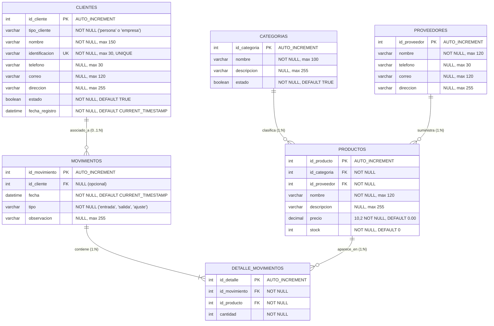

# Modelo Entidad-Relación — StockPro

Este documento detalla la estructura lógica, el diccionario de datos y las relaciones relacionales de la base de datos `stockpro` desarrollada sobre MySQL 8.0 con codificación `utf8mb4`.

---

## 1. Diagrama Entidad-Relación (Mermaid)

---

## 2. Diccionario de Datos

### 2.1. Tabla: `categorias`
Clasificación de productos comerciales en el catálogo.

| Campo | Tipo SQL | Nulo | Clave | Valor por Defecto | Descripción |
| :--- | :--- | :---: | :---: | :---: | :--- |
| `id_categoria` | `INT` | No | **PK** | `AUTO_INCREMENT` | Identificador único de la categoría. |
| `nombre` | `VARCHAR(100)` | No | | Ninguno | Nombre descriptivo (ej: Abarrotes, Bebidas). |
| `descripcion` | `VARCHAR(255)` | Sí | | `NULL` | Notas explicativas de la categoría. |
| `estado` | `TINYINT(1)` / `BOOLEAN` | No | | `1` (TRUE) | Estado operativo (`1` = Activa, `0` = Inactiva). |

---

### 2.2. Tabla: `proveedores`
Empresas fabricantes o distribuidoras que suministran mercancías.

| Campo | Tipo SQL | Nulo | Clave | Valor por Defecto | Descripción |
| :--- | :--- | :---: | :---: | :---: | :--- |
| `id_proveedor` | `INT` | No | **PK** | `AUTO_INCREMENT` | Identificador único del proveedor. |
| `nombre` | `VARCHAR(120)` | No | | Ninguno | Razón social o nombre comercial del proveedor. |
| `telefono` | `VARCHAR(30)` | Sí | | `NULL` | Teléfono de contacto o atención a pedidos. |
| `correo` | `VARCHAR(120)` | Sí | | `NULL` | Correo electrónico comercial. |
| `direccion` | `VARCHAR(255)` | Sí | | `NULL` | Ubicación de bodega o despacho del proveedor. |

---

### 2.3. Tabla: `productos`
Artículos comerciales administrados en el almacén.

| Campo | Tipo SQL | Nulo | Clave | Valor por Defecto | Descripción |
| :--- | :--- | :---: | :---: | :---: | :--- |
| `id_producto` | `INT` | No | **PK** | `AUTO_INCREMENT` | Identificador único del producto. |
| `id_categoria` | `INT` | No | **FK** | Ninguno | Referencia a la tabla `categorias(id_categoria)`. |
| `id_proveedor` | `INT` | No | **FK** | Ninguno | Referencia a la tabla `proveedores(id_proveedor)`. |
| `nombre` | `VARCHAR(120)` | No | | Ninguno | Nombre del producto comercial con presentación. |
| `descripcion` | `VARCHAR(255)` | Sí | | `NULL` | Especificaciones de empaque, peso o notas. |
| `precio` | `DECIMAL(10,2)` | No | | `0.00` | Precio unitario de venta. |
| `stock` | `INT` | No | | `0` | Existencias físicas reales en almacén. |

---

### 2.4. Tabla: `clientes`
Compradores o receptores de salidas de mercancía, personas o empresas.

| Campo | Tipo SQL | Nulo | Clave | Valor por Defecto | Descripción |
| :--- | :--- | :---: | :---: | :---: | :--- |
| `id_cliente` | `INT` | No | **PK** | `AUTO_INCREMENT` | Identificador único del cliente. |
| `tipo_cliente` | `VARCHAR(20)` | No | | Ninguno | Modalidad de cliente: `'persona'` o `'empresa'`. |
| `nombre` | `VARCHAR(150)` | No | | Ninguno | Nombre completo o razón social de la empresa. |
| `identificacion` | `VARCHAR(30)` | No | **UK** | Ninguno | Cédula física, jurídica o tax ID único. |
| `telefono` | `VARCHAR(30)` | Sí | | `NULL` | Teléfono de contacto. |
| `correo` | `VARCHAR(120)` | Sí | | `NULL` | Correo electrónico de facturación o contacto. |
| `direccion` | `VARCHAR(255)` | Sí | | `NULL` | Dirección de entrega o domicilio social. |
| `estado` | `TINYINT(1)` / `BOOLEAN` | No | | `1` (TRUE) | Estado operativo (`1` = Activo, `0` = Inactivo). |
| `fecha_registro` | `DATETIME` | No | | `CURRENT_TIMESTAMP` | Fecha y hora en la que se registró al cliente. |

---

### 2.5. Tabla: `movimientos`
Cabecera de transacciones de inventario en bodega.

| Campo | Tipo SQL | Nulo | Clave | Valor por Defecto | Descripción |
| :--- | :--- | :---: | :---: | :---: | :--- |
| `id_movimiento` | `INT` | No | **PK** | `AUTO_INCREMENT` | Identificador único del movimiento. |
| `id_cliente` | `INT` | Sí | **FK** | `NULL` | Referencia opcional a `clientes(id_cliente)`. |
| `fecha` | `DATETIME` | No | | `CURRENT_TIMESTAMP` | Fecha y hora exacta en que se efectuó la operación. |
| `tipo` | `VARCHAR(20)` | No | | Ninguno | Tipo de operación: `'entrada'`, `'salida'`, `'ajuste'`. |
| `observacion` | `VARCHAR(255)` | Sí | | `NULL` | Motivo de la operación (compra, entrega, etc.). |

---

### 2.6. Tabla: `detalle_movimientos`
Desglose de artículos y cantidades que componen un movimiento.

| Campo | Tipo SQL | Nulo | Clave | Valor por Defecto | Descripción |
| :--- | :--- | :---: | :---: | :---: | :--- |
| `id_detalle` | `INT` | No | **PK** | `AUTO_INCREMENT` | Identificador único de la línea de detalle. |
| `id_movimiento` | `INT` | No | **FK** | Ninguno | Referencia a `movimientos(id_movimiento)`. |
| `id_producto` | `INT` | No | **FK** | Ninguno | Referencia a `productos(id_producto)`. |
| `cantidad` | `INT` | No | | Ninguno | Unidades involucradas en la transacción. |

---

## 3. Relaciones y Claves Foráneas

| Restricción FK | Tabla Origen | Columna Origen | Tabla Destino | Columna Destino | ON UPDATE | ON DELETE | Justificación Empresarial |
| :--- | :--- | :--- | :--- | :--- | :---: | :---: | :--- |
| `fk_productos_categorias` | `productos` | `id_categoria` | `categorias` | `id_categoria` | `CASCADE` | `RESTRICT` | Impide borrar categorías que contengan productos activos en almacén. |
| `fk_productos_proveedores` | `productos` | `id_proveedor` | `proveedores` | `id_proveedor` | `CASCADE` | `RESTRICT` | Impide borrar proveedores que suministren productos en catálogo. |
| `fk_movimientos_clientes` | `movimientos` | `id_cliente` | `clientes` | `id_cliente` | `CASCADE` | `RESTRICT` | Protege el historial de despachos; el cliente no puede borrarse si tiene movimientos. |
| `fk_detalle_movimientos_movimiento` | `detalle_movimientos` | `id_movimiento` | `movimientos` | `id_movimiento` | `CASCADE` | `CASCADE` | Si se elimina un movimiento de forma transaccional, sus renglones se eliminan coherentemente. |
| `fk_detalle_movimientos_producto` | `detalle_movimientos` | `id_producto` | `productos` | `id_producto` | `CASCADE` | `RESTRICT` | Impide borrar productos que posean historial de movimientos para no alterar auditorías. |

---

## 4. Reglas de Negocio del Modelo

1. **Integridad de Stock:**
   - La cantidad registrada en una `salida` no puede exceder el valor actual de `stock` en la tabla `productos`.
   - Una `entrada` suma algebraicamente la cantidad al `stock`.
   - Un `ajuste` aplica correcciones directas (+ o -), validando que `stock + cantidad >= 0`.
2. **Reversión Obligatoria:**
   - Si se edita o cancela un movimiento, el sistema calcula el inverso del efecto previo antes de aplicar la nueva variación, impidiendo estados huérfanos o desbalanceados.
3. **Unicidad de Identificación:**
   - La columna `identificacion` de `clientes` tiene índice `UNIQUE`. No se admiten cédulas físicas o jurídicas repetidas.
4. **Composición de Movimientos:**
   - Un movimiento debe contener como mínimo un detalle (`detalle_movimientos`) asociado.

